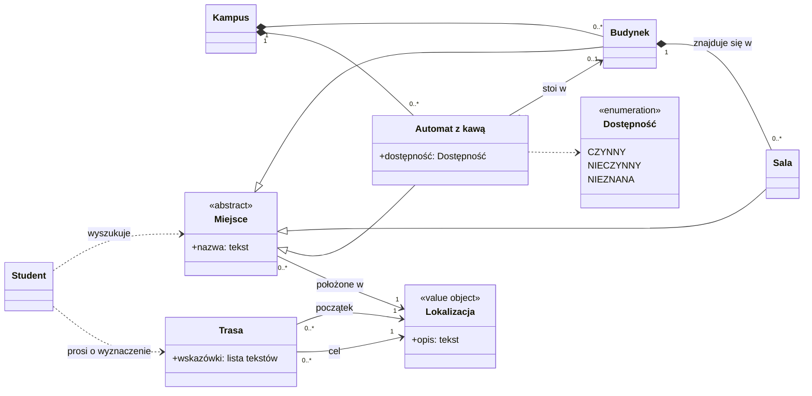

# Model dziedziny

Model dziedziny (Domain Model) pokazuje pojęcia ze [słownika](glossary.md) i relacje między nimi. Opisuje dziedzinę, a nie kod, dlatego używa jej języka i pomija technologię.

Droga do modelu: **słownik → przypadki użycia → diagram klas**.

## Czytamy definicje jak specyfikację

Definicje ze słownika mówią więcej, niż widać na pierwszy rzut oka:

| Fragment słownika | Co z niego wynika |
|---|---|
| Sala — „znajdujące się w budynku” | Sala nie istnieje bez budynku: kompozycja |
| Budynek — „**mogą** znajdować się sale” | Krotność `0..*` |
| Trasa — „łącząca **dwie** lokalizacje” | Dokładnie dwa końce trasy: początek i cel |
| Lokalizacja — „położenie” | Brak własnej tożsamości: obiekt wartości |
| Automat z kawą — „samodzielny zakup kawy” | Zakupu nie modelujemy, bo nie wymaga go żadne wymaganie funkcjonalne |
| Student | Aktor połączony tylko zależnościami: NFR-02 zakazuje przechowywania historii jego lokalizacji |

## Luki znalezione podczas modelowania

Porównanie słownika z [wymaganiami](requirements.md) i [przypadkami użycia](use-cases/README.md) ujawniło pojęcia, których w nim brakowało. Zostały już do niego dodane:

- **Miejsce:** UC-01 oraz FR-02 i FR-03 traktują salę, budynek i automat z kawą jednakowo.
- **Dostępność:** UC-03 (3a) wymaga stanu „nieznana”, więc wartość logiczna tak/nie nie wystarczy.
- **Kampus:** występował w definicjach, ale sam nie był zdefiniowany.

Modelowanie poprawia więc słownik. Ten proces nie jest jednokierunkowy.

## Diagram klas

Nazwą sali jest jej numer, np. A101. Piętra i kodu budynku nie ma, bo nie wymaga ich żaden FR ani UC.

## Założenia i pytania otwarte

- **Założenie:** automat z kawą może stać poza budynkiem (`0..1`), bo słownik tego nie wyklucza. Dane w `src/` zawsze wskazują budynek.
- **Otwarte:** co oznacza, że automat jest czynny. Dlatego diagram nie zawiera godzin pracy.
- **Otwarte:** czy trasa obejmuje wnętrza budynków. Jeśli tak, model może wymagać odcinków trasy.

Oba pytania otwarte pochodzą z [wymagań](requirements.md).
