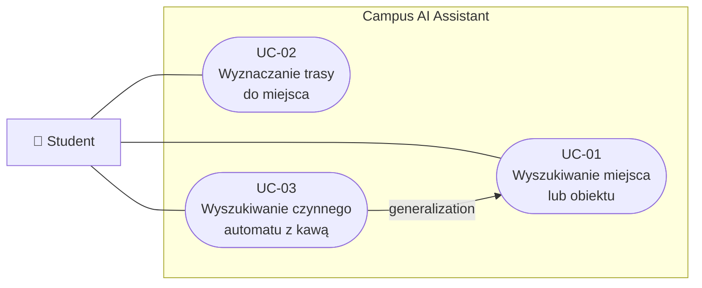
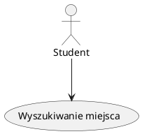
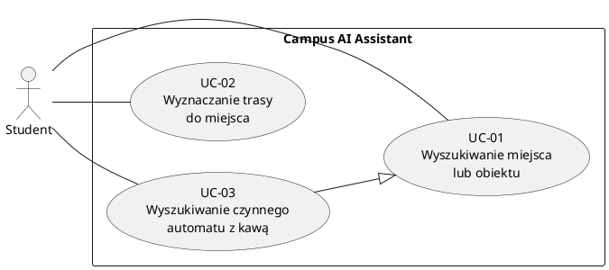

# Przypadki użycia

## Diagram przypadków użycia UML 

Uwaga: Mermaid flowchart nie obsługuje pełnej notacji diagramów przypadków użycia UML. W poprawnym diagramie UML generalizację przedstawia się linią ciągłą z pustym trójkątem skierowanym do UC-01.

## Wersja PlantUML — zgodna z notacją UML

## Katalog przypadków użycia

| ID | Przypadek użycia | Aktor | Wymagania |
|----|------------------|-------|-----------|
| [UC-01](UC-01-search-place.md) | Wyszukiwanie miejsca lub obiektu | Student | FR-01, FR-02, FR-03 |
| [UC-02](UC-02-find-route.md) | Wyznaczanie trasy do miejsca | Student | FR-01, FR-03, FR-04 |
| [UC-03](UC-03-find-coffee-machine.md) | Wyszukiwanie czynnego automatu z kawą | Student | FR-01, FR-02, FR-03, FR-05 |
