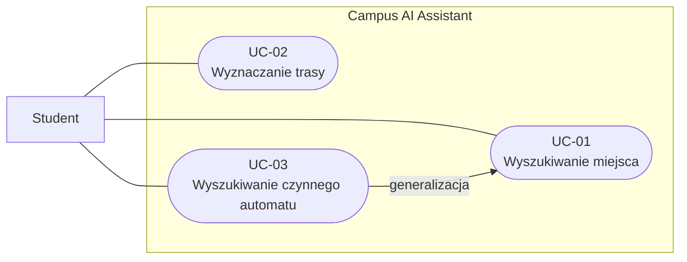
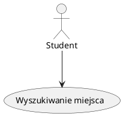
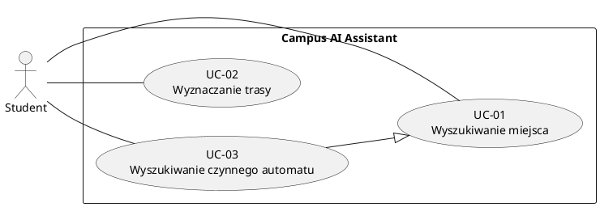

# Przypadki użycia

## Wersja Mermaid 

### 1. Aktor i przypadek użycia

2. Granice systemu i generalizacja

> Uwaga: Mermaid flowchart nie obsługuje pełnej notacji diagramów przypadków użycia UML. W poprawnym diagramie UML generalizację przedstawia się linią ciągłą z pustym trójkątem skierowanym do UC-01.

## Wersja PlantUML — zgodna z notacją UML 

### 1. Aktor i przypadek użycia

### 2. Granice systemu i generalizacja

> GitHub nie obsługuje natywnie renderowania diagramów PlantUML w plikach Markdown — wyświetla jedynie ich kod źródłowy.

> W Visual Studio Code można zainstalować rozszerzenie [Markdown PlantUML Preview](https://marketplace.visualstudio.com/items?itemName=myml.vscode-markdown-plantuml-preview), które umożliwia wyświetlanie diagramów PlantUML bezpośrednio w podglądzie plików Markdown.

## Katalog przypadków użycia

| ID | Przypadek użycia | Aktor | Wymagania |
|----|------------------|-------|-----------|
| [UC-01](UC-01-search-place.md) | Wyszukiwanie miejsca lub obiektu | Student | FR-01, FR-02, FR-03 |
| [UC-02](UC-02-find-route.md) | Wyznaczanie trasy do miejsca | Student | FR-01, FR-03, FR-04 |
| [UC-03](UC-03-find-coffee-machine.md) | Wyszukiwanie czynnego automatu z kawą | Student | FR-01, FR-02, FR-03, FR-05 |
